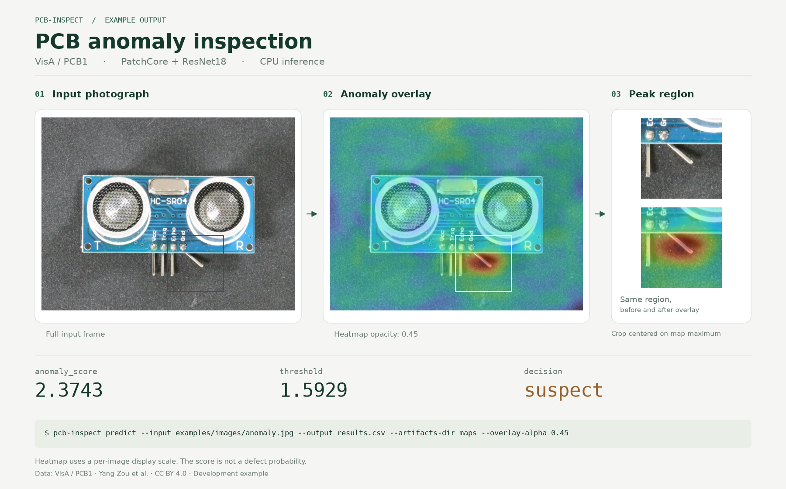

# PCB anomaly inspector

`pcb-inspect` performs command-line anomaly inspection for PCB photographs. A frozen PatchCore model
produces an image score, a fixed-threshold decision, and optional heatmaps. The
included model covers the **PCB1 category of VisA**. It is a reproducible
experiment on one board category; transfer to other boards or camera setups needs
separate validation.

The repository includes the 20.7 MB model checkpoint, its calibration, three real
development images, and a fixed split manifest. Predictions run on CPU by default.



The figure uses a real development image and its saved CPU prediction. The
close-up is centered on the maximum of the raw anomaly map. [Full SVG](docs/images/inspection-demo.svg)
and [source values](docs/images/inspection-demo.json) are included.

## Install

Python 3.11 or 3.12 is required. Run commands from this repository's root.

Using [uv](https://docs.astral.sh/uv/), the lockfile selects CPU PyTorch wheels on
Linux and Windows:

```bash
uv sync --frozen --extra test
uv run pcb-inspect --help
```

Alternatively, install CPU PyTorch explicitly before the package:

```bash
python3.11 -m venv .venv
source .venv/bin/activate
python -m pip install --upgrade pip
python -m pip install torch==2.10.0 torchvision==0.25.0 --index-url https://download.pytorch.org/whl/cpu
python -m pip install -e '.[test]'
pcb-inspect --help
```

The commands below assume the virtual environment is active. `python -m pcb_inspect`
is equivalent to `pcb-inspect`. Model inference and `--help` do not download files.
The checkpoint and examples remain repository assets, so pass their paths with
`--model` and `--input` when running from another directory.

## Predict

```bash
pcb-inspect predict --input examples/images/normal.jpg --output outputs/normal.csv
pcb-inspect predict --input examples/images --output outputs/batch.csv --threads 4
pcb-inspect predict --input examples/manifest.csv --output outputs/examples.csv \
  --artifacts-dir outputs/example-maps --overlay-alpha 0.45
```

The three selected examples contain a correct normal decision, a correct anomaly
decision, and a false alarm. Their labels and source images are recorded in
`examples/manifest.csv` and `examples/provenance.json`. They illustrate behavior;
they are not a representative accuracy sample.

The demonstration overlay was generated by the shipped CLI. Its numerical result is in
[`docs/example-prediction.csv`](docs/example-prediction.csv); red denotes a high
local anomaly score under the display scale.

Stdout is a compact `metric: value` summary. Progress, dependency warnings, and
errors go to stderr. CSV files contain every attempted input, including errors.

| `predict` option | Meaning |
| --- | --- |
| `--input PATH` | Required. A JPEG/PNG file, directory, CSV, or JSONL manifest. Directories are traversed recursively in sorted order. |
| `--output PATH` | Required. Prediction CSV; missing parent directories are created. |
| `--model DIR` | Model directory; default `models/pcb1-v1`. |
| `--device DEVICE` | `cpu` (default), `cuda`, or `cuda:N`. CUDA requires a compatible PyTorch installation. |
| `--threads N` | Positive PyTorch CPU thread count; default `4`. |
| `--split NAME` | Select an exact manifest split. Omit to process all manifest rows. |
| `--artifacts-dir DIR` | Write maps and image artifacts. Omit to write only the CSV. |
| `--overlay-alpha FLOAT` | Heatmap opacity in `[0, 1]`; default `0.45`. `0` shows the original; `1` shows the heatmap. |
| `--overwrite` | Replace an existing CSV and matching artifact files. Unrelated artifact files are retained. |
| `--fail-fast` | Stop after the first image failure. Default behavior records the failure and continues. |
| `--help` | Show command help. All subcommands support this option. |

Each artifact directory has a numeric input index, a sanitized sample ID, and a
hash suffix. It contains `original.png`, `heatmap.png`, `overlay.png`, and
`raw_map.npy`. Display heatmaps use a per-image min/max color scale and a full-frame
bilinear mapping to the input dimensions. Changing opacity changes only
`overlay.png`; raw maps, scores, and decisions are unchanged.

Images are decoded as RGB with EXIF orientation applied. Supported inputs are
JPEG and PNG, at least 16 × 16 pixels, at most 20 megapixels and 20 MiB per file.
Inference processes one image at a time. Input metadata and benchmark scalar
scores are retained in memory; full image batches and output maps are not retained.

## Input and output formats

CSV manifests have a header. JSONL manifests contain one object per line using
the same fields:

```csv
sample_id,path,label,split,sha256
normal-1,images/normal.jpg,0,development,
anomaly-1,images/anomaly.jpg,1,development,
```

`path` is required and is relative to the manifest's directory, unless absolute.
`sample_id` is optional; a stable ID is derived from the path when absent. IDs and
resolved paths must be unique within the selected rows. `label` is `0` for normal,
`1` for anomaly, or empty for unlabeled prediction. `split` is an exact text value.
An optional `sha256` is verified before inference. Extra columns are ignored.
Labels are required for `benchmark`, `fit`, and `calibrate`; unlabeled inputs are
never included in accuracy calculations.

CSV schema version 1 has the following fixed column order:

```text
schema_version,sample_id,input_path,input_sha256,split,label,status,error,score,threshold,decision,model_id,model_sha256,device,threads,inference_seconds,total_seconds,original_path,heatmap_path,overlay_path,raw_map_path
```

| Columns | Meaning |
| --- | --- |
| `schema_version`, `sample_id`, `input_path`, `split`, `label` | Schema version and input metadata. `input_path` preserves the supplied manifest path. |
| `input_sha256` | SHA-256 of the successfully processed image. |
| `status`, `error` | `ok` or `error`; failed rows contain an explicit error and no anomaly score. |
| `score`, `threshold`, `decision` | Unnormalized PatchCore score, fixed threshold, and `normal` or `suspect`. The comparison is strictly `score > threshold`. Failed rows use `error`; calibration score collection uses `needs_review`. |
| `model_id`, `model_sha256` | Human-readable model version and fingerprint of weights plus model/preprocessing specification. |
| `device`, `threads` | Runtime settings; they do not alter model identity. |
| `inference_seconds`, `total_seconds` | Model forward time; complete per-image processing time, including decode, preprocessing, checksum, and optional artifacts. |
| `original_path`, `heatmap_path`, `overlay_path`, `raw_map_path` | Artifact paths relative to the prediction CSV directory. Empty when artifacts are disabled. |

Exit codes are `0` for success, `1` for a model/runtime failure, `2` for usage or
input/output validation, `3` for image failures during prediction or benchmarking,
and `130` for interruption. `--fail-fast` still writes the failed row. Benchmark
metrics count unprocessed rows separately. Existing outputs require `--overwrite`;
input and model files cannot be used as prediction output destinations.

## Benchmark

```bash
pcb-inspect benchmark --input examples/manifest.csv --split examples \
  --output outputs/example-predictions.csv --metrics outputs/example-metrics.json \
  --device cpu --threads 4
```

`benchmark` accepts all prediction options. It additionally requires `--split NAME`
and `--metrics PATH`, and its input must be a labeled manifest. The JSON contains
accuracy, precision, recall, F1, TP/FP/TN/FN, image AUROC, image average precision,
counts, inference/total latency, model/input hashes, and the runtime environment.
Anomaly is the positive class. Ranking metrics require both classes; undefined
metrics are JSON `null`. `accuracy` is an alias of `complete_case_accuracy` on
decided inputs. `all_input_accuracy` also counts failed, undecided, and unprocessed
inputs as incorrect. `metric_denominators` records every denominator; any report
with a failure or unprocessed input is marked `incomplete`.

Latency uses batch size 1 with no warmup, including the first model call. Per-image
latency excludes model loading. `wall_seconds` includes model initialization,
prediction, and metric calculation. Reports record CPU model, core counts,
available affinity, thread count, RAM, Python, and package versions.

### CPU result on the frozen final test

Measured on November 9, 2026: **AMD Ryzen 7 5800X, 4 PyTorch CPU threads**, Linux,
Python 3.11.16, PyTorch `2.10.0+cpu`, torchvision `0.25.0+cpu`, anomalib 2.6.2.
The frozen model processed all 180 held-out PCB1 images: 100 normal and 80 anomalous.
There were no failed, undecided, or omitted inputs. Batch size was 1, with no
warmup and artifacts disabled. Accuracy uses all 180 inputs.

| Metric | Value |
| --- | ---: |
| Accuracy | 91.11% |
| Precision | 89.02% |
| Recall | 91.25% |
| F1 | 0.901235 |
| Image AUROC | 0.948750 |
| Image average precision | 0.931456 |
| TP / FP / TN / FN | 73 / 9 / 91 / 7 |
| Inference p50 / p95 | 38.59 / 41.95 ms |
| Total per-image p50 / p95 | 47.99 / 52.06 ms |
| Wall time, including model initialization | 11.99 s |
| Peak process RSS | 779.57 MiB |

The fixed threshold is `1.5928595066070557`. Individual predictions and full
conditions are in [`reports/final-test-cpu-v1`](reports/final-test-cpu-v1). This is a
custom frozen split protocol on VisA, not the official VisA benchmark. Hardware,
dependency versions, thread count, image decoding, and first-call initialization
affect timing.

The [historical GPU baseline](reports/baseline-gpu-v1) used CUDA device 1,
**Tesla V100-SXM2-32GB**, with thread count 4. It has the same confusion matrix,
AUROC, and average precision; inference p50/p95 were 5.18/11.80 ms. That report was
imported without changing scores or rerunning inference. The GPU name is verified
against the recorded PyTorch device mapping, which differs from `nvidia-smi` order.

## Reproduce the full PCB1 experiment

The checked-in `data/pcb1-splits.csv` preserves all 1,104 image identities and splits:
604 `fit_normal`, 200 `calibration_normal`, 100 `dev_normal`, 20 `dev_anomaly`, and
180 `final_test`. No dataset images beyond the three examples are bundled.

Download the official 1.93 GB archive explicitly, then verify and extract only the
manifest's PCB1 images:

```bash
curl --fail --location https://amazon-visual-anomaly.s3.us-west-2.amazonaws.com/VisA_20220922.tar \
  --output data/VisA_20220922.tar
pcb-inspect prepare-data --archive data/VisA_20220922.tar
pcb-inspect benchmark --input data/pcb1-splits.csv --split final_test \
  --output outputs/final-test-cpu.csv --metrics outputs/final-test-cpu.json \
  --model models/pcb1-v1 --device cpu --threads 4
```

`prepare-data` verifies the full official archive SHA-256 and every extracted image.
It does not modify the split manifest. Options: `--archive PATH` is required;
`--output-dir DIR` defaults to `data/visa` and must not exist; `--manifest PATH`
defaults to `data/pcb1-splits.csv`. A different extraction destination requires a
corresponding manifest path layout for subsequent inference.

### Fit a separate experiment

Fitting uses only rows labeled `0`. It loads a local ResNet18 ImageNet checkpoint
with an exact checksum; it never substitutes labels, filenames, or fixtures for
inference. Extracted image batches are bounded by `--batch-size`; PatchCore retains
training patch embeddings until coreset selection, so training memory grows with
the number of fit images.

```bash
mkdir -p backbones
curl --fail --location https://download.pytorch.org/models/resnet18-f37072fd.pth \
  --output backbones/resnet18-f37072fd.pth
pcb-inspect fit --input data/pcb1-splits.csv --split fit_normal \
  --backbone-weights backbones/resnet18-f37072fd.pth \
  --output-model experiments/pcb1-fit --device cpu --threads 4
pcb-inspect calibrate --input data/pcb1-splits.csv --split calibration_normal \
  --model experiments/pcb1-fit --output-model experiments/pcb1-calibrated \
  --alpha 0.05 --device cpu --threads 4
```

| `fit` option | Meaning |
| --- | --- |
| `--input PATH` | Required labeled CSV/JSONL manifest. |
| `--split NAME` | Exact normal-only split; default `fit_normal`. |
| `--backbone-weights PATH` | Required local official `resnet18-f37072fd.pth`. |
| `--output-model DIR` | Required new output directory. Existing models cannot be overwritten. |
| `--batch-size N` | Positive image batch size; default `8`. |
| `--coreset-ratio FLOAT` | Retained patch fraction in `(0, 1)`; default `0.01`. |
| `--seed N` | Integer from `0` to `4294967295`; default `42`. |
| `--device DEVICE`, `--threads N` | Runtime settings, default `cpu` and `4`. |

| `calibrate` option | Meaning |
| --- | --- |
| `--input PATH` | Required labeled CSV/JSONL manifest. |
| `--split NAME` | Separate normal-only split; default `calibration_normal`. |
| `--model DIR` | Source model; default `models/pcb1-v1`. |
| `--output-model DIR` | Required new model copy with the calibrated threshold. Source model is unchanged. |
| `--alpha FLOAT` | Target normal false-reject fraction in `(0, 1)`; default `0.05`. |
| `--device DEVICE`, `--threads N` | Runtime settings, default `cpu` and `4`. |

Calibration rejects duplicate image contents and any SHA-256 overlap with fitting.
It chooses the `ceil((n + 1) × (1 - alpha))`-th ordered normal score. At `alpha=0.05`,
at least 19 independent normal images are needed; the frozen model used 200. New
fit and calibration runs are separate experiments. Keep the final test held out
and do not adjust hyperparameters or thresholds after observing its results.

## Model and resources

The frozen model uses anomalib 2.6.2 PatchCore, ResNet18 layers `layer2` and `layer3`,
9 neighbors, a 1% coreset, float32, and a `6184 × 384` memory bank. Preprocessing is
Pillow RGB bilinear full-frame resize to 256 × 256 with ImageNet mean/std, without
cropping. Automatic anomalib postprocessing is disabled.

`model.pt` is 20,683,057 bytes, SHA-256
`95b5dd11f458d7f05cff5e75d570092b0961c493325ecc53868239cac2b00e1c`.
Model metadata, threshold, and fit registry are portable. Checksums are verified
before inference. Runtime device and thread overrides are outside the model
fingerprint; score differences of a few floating-point units across devices are
expected.

All 180 CPU final-test decisions matched the saved GPU decisions; the largest
absolute score difference was `0.0000157356262`. No threshold or model parameters
were changed after inspecting these results.

```bash
pcb-inspect model-info --model models/pcb1-v1
```

`model-info` accepts `--model DIR` and `--help`; it verifies weights, metadata, fit
registry, and threshold without importing PyTorch. Global `--version` prints the
application version. A 256 × 256 float32 raw map is approximately 256 KiB; optional
full-resolution PNG artifacts take additional disk space. Installation includes
PyTorch and anomalib's scientific dependencies; the CPU environment is substantially
larger than the checkpoint.

## Verification and attribution

```bash
python -m pytest -q
PCB_INSPECT_REAL_TEST=1 python -m pytest -q tests/test_real_inference.py
```

The full CPU suite passed 33 tests, including the real checkpoint/overlay test.

Contract tests cover input schemas, early validation, output protection, explicit
image failures, split preservation, metric denominators, and calibration overlap.
The optional real test loads the shipped checkpoint on CPU, compares all three
development scores with the source GPU predictions within `1e-4`, and verifies
that opacity changes only display artifacts. It performs real model inference.
Recorded installation, split, score-comparison, and training-smoke checks are in
[`reports/verification.json`](reports/verification.json).

Data: VisA, Yang Zou et al., CC BY 4.0. PatchCore: Karsten Roth et al.; implementation
by anomalib, Apache-2.0. ResNet18: torchvision/ImageNet pretrained weights. See
[`THIRD_PARTY_NOTICES.md`](THIRD_PARTY_NOTICES.md), [`licenses`](licenses), and the
model/example provenance files for attribution, source revisions, and hashes.

To rebuild the README figure from the saved outputs, install
`docs/figure-requirements.txt` in a separate documentation environment and run
`python docs/render_demo.py`. Rendering does not rerun inference or modify scores.
